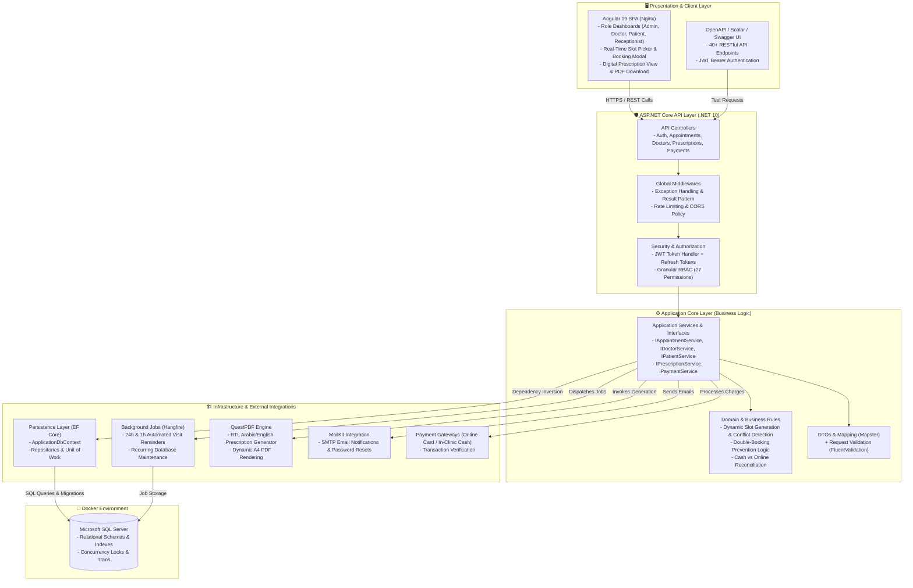

# 🏥 Medical Clinic Management System (Clean Architecture)

[](https://dotnet.microsoft.com/)
[](https://learn.microsoft.com/aspnet/core/)
[](https://angular.dev/)
[](https://www.microsoft.com/sql-server)
[](https://www.docker.com/)
[](https://www.hangfire.io/)
[](https://www.questpdf.com/)

A production-ready healthcare management platform designed to eliminate clinic waiting times, prevent appointment double-bookings, automate medical communication, and streamline bilingual digital prescriptions.

> 💡 **Notice:** Looking for the initial monolithic version? It is preserved in the [`v1-legacy`](https://github.com/omar-mahrem/Medical_Clinic/tree/v1-legacy) branch.

---

## 🏗️ System Architecture

Built following **Clean Architecture** principles to achieve high maintainability, strict separation of concerns, and testability.



---

## 📁 Solution Structure

```text
├── MedicalClinic.Core/            # Enterprise Domain entities, Enums, Custom Errors, Constants
├── MedicalClinic.Application/     # CQRS/Services, Business Rules, DTOs, FluentValidation, Interfaces
├── MedicalClinic.Infrastructure/  # EF Core DbContext, Configurations, Migrations, QuestPDF, Hangfire, Mail
├── MedicalClinic.Api/             # Web API Host (.NET 10), Controllers, Middlewares, Dependency Injection
├── MedicalClinic.Client/          # Angular 19 SPA (Tailwind CSS, Standalone Components, Signals)
├── docker-compose.yml             # Orchestration for Frontend, Backend, and SQL Server
└── README.md
```

---

## 🚀 Key Features

### 📅 Smart Appointment Engine
- **Configurable Time Slots:** Automatic slot generation based on doctor shifts and visit duration.
- **Concurrency & Conflict Detection:** Prevents simultaneous duplicate reservations.
- **Walk-in & Online Booking:** Accommodates both reception-booked walk-ins and direct online patient bookings.

### 📋 Bilingual Digital Prescriptions (QuestPDF)
- **RTL Arabic/English Localization:** Custom font stream loading (Arial/Tahoma) ensuring crisp, native Arabic typography.
- **Comprehensive Details:** Diagnosis, medication names, dosages, frequencies, and doctor signatures.
- **One-Click Instant Download:** Generates downloadable A4 PDF records on demand.

### 🔐 Multi-Tier Security & RBAC
- **4 Distinct Roles:** Admin, Doctor, Patient, Receptionist.
- **27 Granular Permissions:** Precise operation-level authorization (`Appointments.Create`, `Prescriptions.Write`, etc.).
- **JWT + Refresh Token Rotation:** Secure session lifetime and token revocation handling.

### 💳 Dual-Mode Billing & Payments
- **Online Pre-payments:** Card payment flow with instant confirmation.
- **In-Clinic Cash Workflow:** Verified collection upon physical clinic arrival with reconciliation.

### ⏳ Automated Background Tasks (Hangfire)
- **Automated Notifications:** Sends transactional visit confirmations, 24-hour reminders, and 1-hour pre-appointment alerts.
- **Clean Background Dashboard:** Real-time visibility into enqueued and scheduled background tasks.

---

## 🐳 Quick Start with Docker Compose

Run the entire system (Frontend + Backend + Database) in a single command:

```bash
# Clone the repository
git clone https://github.com/omar-mahrem/Medical_Clinic.git
cd Medical_Clinic

# Start all services with Docker Compose
docker compose up --build -d
```

### Access URLs:
- **Angular Client:** `http://localhost:8080`
- **Swagger / API Endpoints:** `http://localhost:5000/swagger`
- **Hangfire Dashboard:** `http://localhost:5000/hangfire`
- **SQL Server:** `localhost:14333`

---

## 🛠️ Local Development (Without Docker)

### Prerequisites:
- [.NET 10 SDK](https://dotnet.microsoft.com/download/dotnet/10.0)
- [Node.js 20+ & npm](https://nodejs.org/)
- [SQL Server](https://www.microsoft.com/sql-server) or LocalDB

### Backend:
```bash
cd MedicalClinic.Api
dotnet restore
dotnet ef database update --project ../MedicalClinic.Infrastructure
dotnet run
```

### Frontend:
```bash
cd MedicalClinic.Client
npm install
npm start
```

---

## 👨‍💻 Author

**Omar Mahrem**
- LinkedIn: [omar-mahrem](https://www.linkedin.com/in/omar-mahrem-b85431381/)
- GitHub: [omar-mahrem](https://github.com/omar-mahrem)
- Email: omarmahrem.dev@gmail.com
